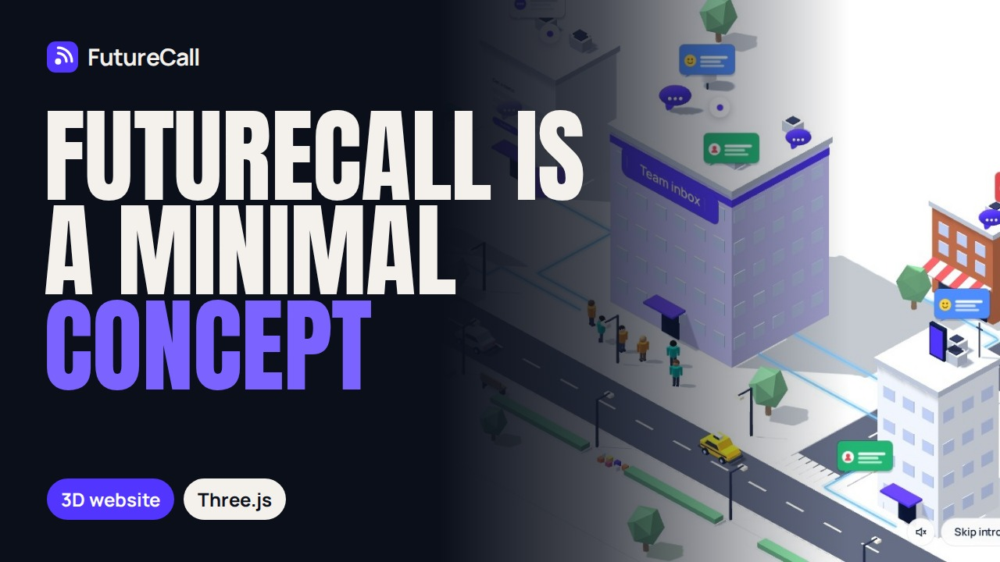

# FutureCall — 3D landing page concept

**[🌐 Live demo](https://sergevei.github.io/futurecall/)** · **[▶ Video on YouTube](https://www.youtube.com/watch?v=y18ETziJP5M)**

A concept landing page for a fictional sales texting and calling platform. Scrolling drives a camera through an isometric 3D city that follows one lead from a website form to a closed deal. Below the tour: product sections, a live 3D coverage map of North America, a mobile menu and a developer footer.

FutureCall is not a real company. Features, numbers, customers and reviews are placeholders.

## Features

- Scroll-driven 3D tour (Three.js, orthographic isometric camera) with 7 scenes, hotspots and a night scene
- Animated traffic, pedestrians, street lights, clouds, lake and per-scene details
- 3D coverage map: routes from the Austin hub to 15 cities, distances in miles, camera fly-to on click
- Product tabs with live interface illustrations, AI section, integrations, use cases, results, mobile app with a rotating 3D phone
- Scrolling "concept" banner, mobile menu with focus trap, smooth scrolling
- Light and dark themes, keyboard navigation, reduced-motion support
- SEO: Open Graph, Twitter Card, canonical, Schema.org (WebSite, WebPage, Person), sitemap, full favicon set

## Author

Designed and developed by **Siarhei Vei** — interactive 3D websites built from scratch.

- Telegram: [@vsergeserge](https://t.me/vsergeserge)
- Portfolio: https://sergevei.github.io/
- Also see: [NordFreight](https://sergevei.github.io/nordfreight/)
